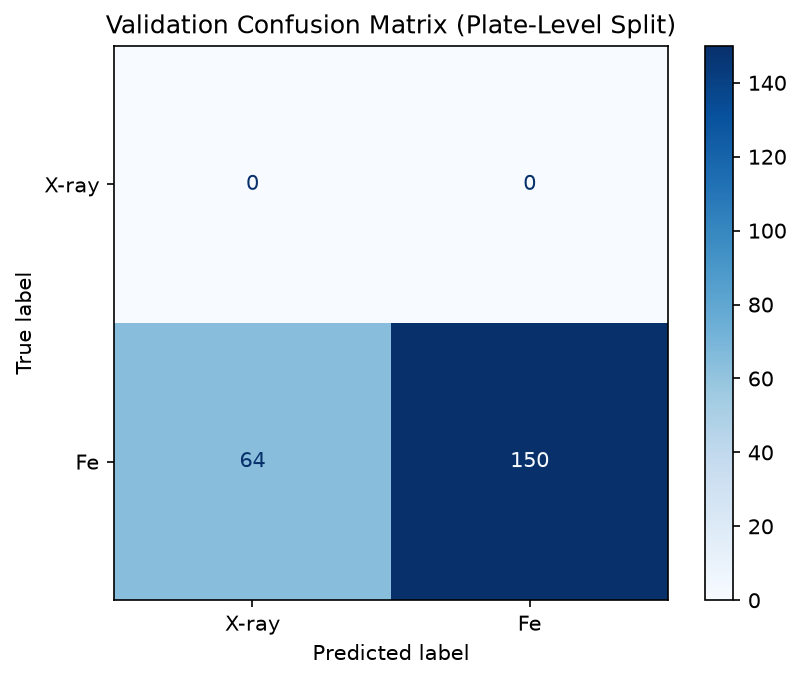
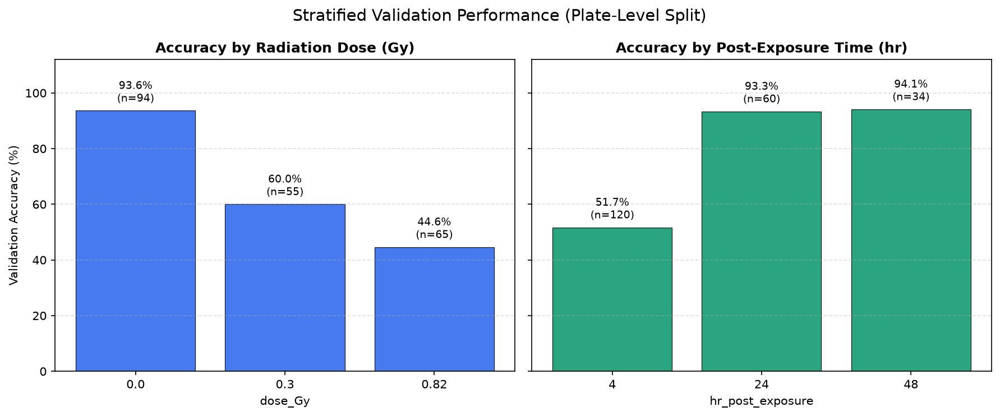
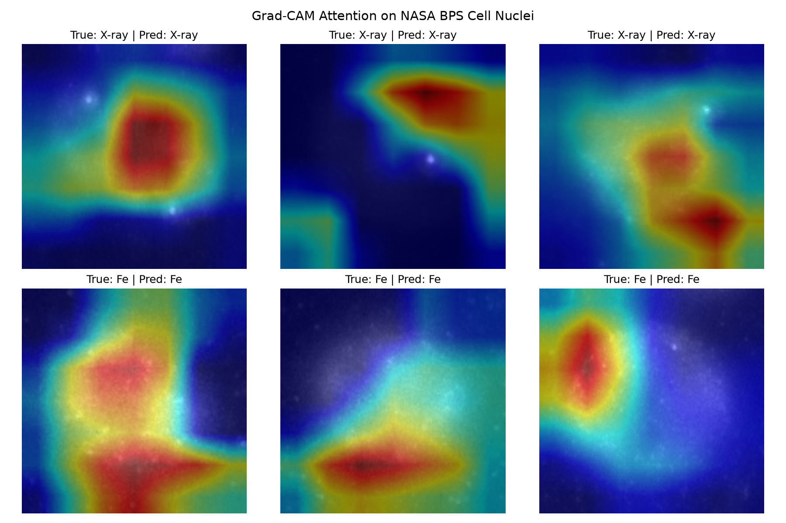

# Explainable Classification of Space Radiation DNA Damage (NASA BPS Microscopy)

A leakage-free PyTorch computer vision pipeline for classifying High-LET Galactic Cosmic Radiation ($^{56}\text{Fe}$) versus Low-LET X-ray exposure in mouse fibroblast nuclei using the NASA Biological and Physical Sciences (BPS) Microscopy Benchmark Dataset.

## Motivation

High-LET heavy ions ($^{56}\text{Fe}$) deposit dense energy along linear tracks, creating persistent clusters of 53BP1 DNA double-strand break foci. Low-LET X-rays deposit energy sparsely, producing diffuse foci that repair more rapidly. This project establishes a reproducible deep learning baseline that enforces biological data hygiene (plate-level group splitting), dose and time-stratified evaluation, and Grad-CAM interpretability.

## Methodology

* **Direct NASA S3 Ingestion:** Fetches `meta.csv` and 16-bit grayscale `.tif` images anonymously from `s3://nasa-bps-training-data/Microscopy/` using multi-threaded `boto3` downloads.
* **Leakage-Free Splitting:** Extracts biological plate IDs from image filenames and applies `GroupShuffleSplit` (80/20) so cells from the same physical slide never appear in both training and validation sets.
* **Preprocessing:** Min-max normalizes raw 16-bit TIFFs to `[0, 1]`, expands to 3 channels, resizes to `224x224`, and applies ImageNet normalization.
* **Model:** Pretrained `ResNet-18` fine-tuned with `AdamW` (`lr=1e-4`, `weight_decay=1e-2`) and FP16 Automatic Mixed Precision.

## Results (Plate-Level Validation)

| Metric | Score |
| :--- | :---: |
| **Best Validation F1-Score** | `0.8242` |
| **Best Validation Accuracy** | `70.09%` |
| **Split Strategy** | `GroupShuffleSplit` (Plate ID) |
| **Subset Size** | `1,000` nuclei (`500` Fe / `500` X-ray) |

### Confusion Matrix


### Stratified Performance by Dose and Repair Kinetics


* **Repair Kinetics (`hr_post_exposure`):** Accuracy rises from `51.67%` at `4.0 hr` (n=120) to `93.33%` at `24.0 hr` (n=60) and `94.12%` at `48.0 hr` (n=34). Early timepoints show heavy initial foci across both radiation types, while later timepoints reflect faster repair of Low-LET X-ray damage relative to persistent High-LET $^{56}\text{Fe}$ clusters.
* **Dose Variance (`dose_Gy`):** Accuracy is `93.62%` at `0.0 Gy` (n=94), `60.00%` at `0.3 Gy` (n=55), and `44.62%` at `0.82 Gy` (n=65). The drop at higher doses under a strict plate-level split highlights domain shift across individual plates in a 1,000-image subset, motivating full-dataset training with 5-fold `GroupKFold` cross-validation.

### Model Interpretability (Grad-CAM)


Grad-CAM overlays extracted from `model.layer4[-1]` verify whether attention localizes on intra-nuclear 53BP1 foci rather than background artifacts.

## Repository Structure

```text
nasa-bps-radiation/
├── requirements.txt
├── outputs/
│   ├── metrics.json
│   ├── val_split.csv
│   ├── confusion_matrix.png
│   ├── stratified_accuracy.png
│   └── gradcam_comparison.png
└── src/
    ├── config.py
    ├── download_subset.py
    ├── dataset.py
    ├── train.py
    └── explain_gradcam.py
```

## Quickstart

```bash
git clone [https://github.com/vector1505/nasa-bps-radiation.git](https://github.com/vector1505/nasa-bps-radiation.git)
cd nasa-bps-radiation
python -m venv .venv
source .venv/bin/activate
pip install -r requirements.txt

python src/download_subset.py
python src/train.py
python src/explain_gradcam.py
```

## Data Attribution

* **Dataset:** NASA Biological and Physical Sciences (BPS) Microscopy Benchmark Training Dataset (`s3://nasa-bps-training-data/Microscopy/`), NASA Open Science Data Repository (OSDR).
* **Interpretability:** Selvaraju et al., *Grad-CAM: Visual Explanations from Deep Networks via Gradient-based Localization* (ICCV 2017).